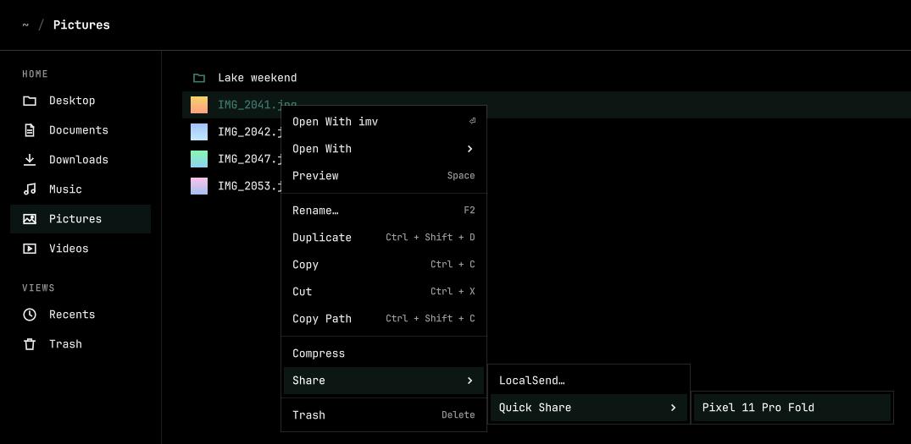
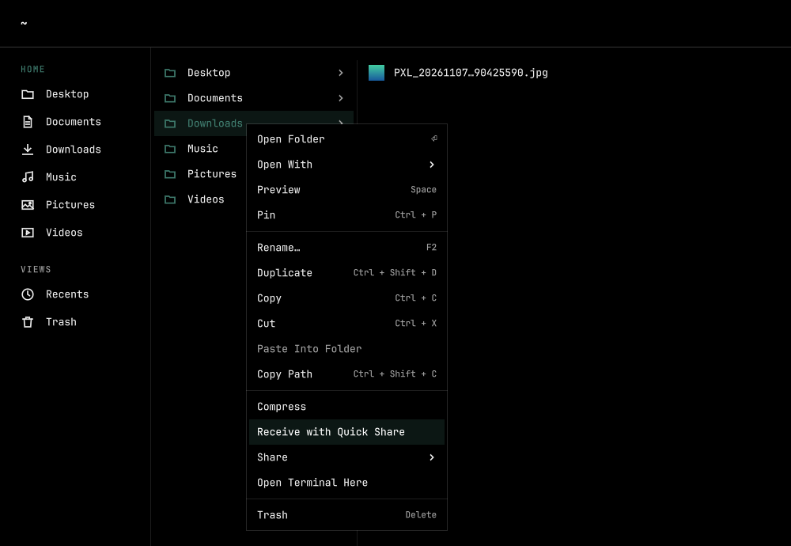
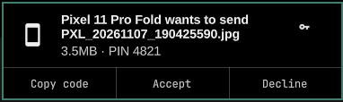

<p align="center">
  
</p>

# folio-quickshare

A [Folio](https://github.com/omacom/folio) plugin that sends and receives files with nearby Android devices over Quick Share. The phone uses Android's built-in Quick Share, so it needs no extra app.

```sh
git clone https://github.com/JaxonWright/folio-quickshare ~/.local/share/folio/plugins/quickshare
```

## Features

### Sending

Select files, right-click, and pick a nearby device under **Share › Quick Share**. Folio says it is sending in its status bar until the phone's owner taps Accept, then says the files were sent.



> [!NOTE]
> Your phone must have its Quick Share visibility temporarily set to **Everyone**, or have the Quick Share receive screen open. As of now, there is no way to sign in with your Google account so that your computer counts as one of your own Quick Share devices.

### Receiving

Right-click a folder and choose **Receive with Quick Share**. The computer then shows up in the phone's share sheet under its hostname, and the files you accept land in that folder.



Nothing is saved without asking. Each transfer shows a notification with the sender, the files, their size and the PIN to match against the phone.



> [!NOTE]
> If your firewall blocks the port phones connect to _(53318)_, the first time you set a folder up to receive with Quick Share you will be prompted for your password, so the plugin can open that port. If the port is already open, there is no prompt.

## Requirements

- Folio 0.4.0 or newer.
- Omarchy on x86_64 or aarch64. On other architectures, build [quickshare](https://github.com/JaxonWright/quickshare) 0.3.0 or newer and put it on `PATH`.
- `jq`, `curl`, `notify-send` and a `systemd` user session, which Omarchy already has out of the box.

## Install

```sh
git clone https://github.com/JaxonWright/folio-quickshare ~/.local/share/folio/plugins/quickshare
```

Press F5 in an open Folio window, or start Folio. That is the whole install. On its first poll the plugin downloads the [quickshare](https://github.com/JaxonWright/quickshare/releases) release it pins, about 6 MB, into its own `bin/` folder, and checks it against a SHA-256 written in `lib.sh`. A slow download carries on over the next polls. Phones start showing up once it finishes.

## Update

To update, run `git pull` in that folder. An update also moves the pinned quickshare version, so the two always match.

```sh
cd ~/.local/share/folio/plugins/quickshare && git pull
```

## Remove

Stop receiving first, so no service is left running a plugin that is gone, then delete the plugin and what it keeps. The last line closes the port that receiving opened in the firewall.

```sh
systemctl --user disable --now folio-quickshare-receive.service
rm -f ~/.config/systemd/user/folio-quickshare-receive.service
rm -rf ~/.local/share/folio/plugins/quickshare ~/.local/state/folio-quickshare
sudo ufw delete allow 53318/tcp
```

> [!NOTE]
> Once Folio has its own way to manage third-party plugins, these steps will move to it.

## Behavior

### Sending

Every 10 seconds Folio runs `poll`, which runs `quickshare browse --no-wake` for 2 seconds and lists each device it hears. `--no-wake` matters here. Folio polls in the background whether or not a menu is open, and a plain `browse` sends the Bluetooth advertisement that wakes Quick Share on every phone in range. So a phone shows up under **Quick Share** only while it is already visible, which usually means its Quick Share screen is open or its visibility is set to Everyone. The submenu is hidden while no device is visible.

Choosing a device runs `send`, which runs `quickshare send` and waits for the phone's owner to tap Accept. The send wakes that phone. While it waits and copies, Folio shows "Sending to" and the device's name, then "Sent to" and the name, or why it did not go: the owner declined, cancelled, or quickshare's own error. Closing Folio ends a send that is still running.

The entry is hidden while a folder is selected, because Quick Share sends files.

Sending needs no firewall rule, because this computer opens every connection.

### Receiving

**Receive with Quick Share** on a folder starts a systemd user service, `folio-quickshare-receive.service`, that runs `quickshare receive` into that folder. It keeps running after Folio closes and starts again at the next login. While it runs, the folder carries the Quick Share mark in Folio's sidebar, and phones nearby list this computer by its hostname. **Stop Receiving with Quick Share**, on any folder, stops the service and disables it.

Check that the PIN in the notification matches the one on the phone before you accept. Closing the notification, or leaving it for a minute, declines. When files arrive, a notification names them and has a button that opens the folder in Folio.

A phone connects to this computer to send, so the firewall has to allow TCP port 53318, and Omarchy's ufw denies incoming connections. **Receive with Quick Share** runs `quickshare doctor` first. When ufw blocks the port, it asks for your password in the desktop's prompt and adds the rule `ufw allow 53318/tcp comment quickshare`, once. If you cancel the prompt, or another firewall blocks the port, it refuses and shows the fix to run yourself.

## Tests

```sh
tests/run
```

The tests run the plugin's commands against stand-ins for `quickshare`, `systemctl`, `notify-send`, `pkexec` and `ufw`, and check what Folio, systemd, the notification and the firewall would get. They never touch the real firewall or show a password prompt.

## License

GPL-3.0-only, to match quickshare. See `LICENSE`.

The Folio logo in `assets/header.svg` is copied from [Folio](https://github.com/omacom/folio), Copyright (c) 2026 David Heinemeier Hansson, under the MIT license in `assets/FOLIO-LICENSE`. Quick Share is a trademark of Google. The Quick Share mark in `assets/header.svg` and `quickshare.svg` is a tracing of Google's icon, and this project is not affiliated with Google.
